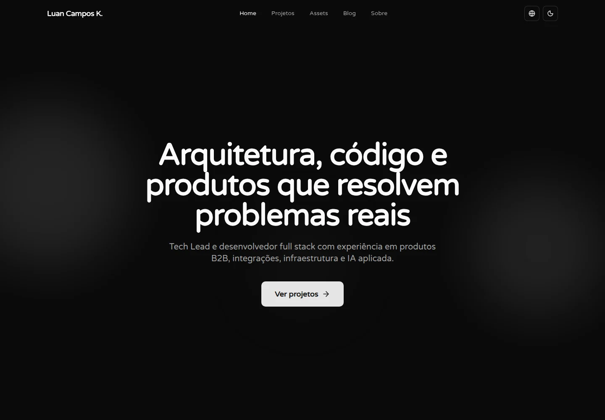
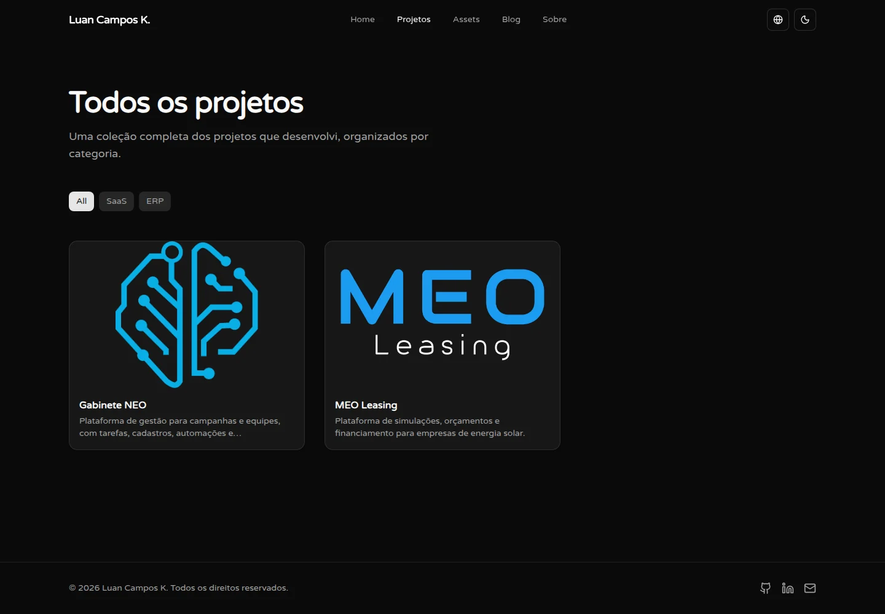
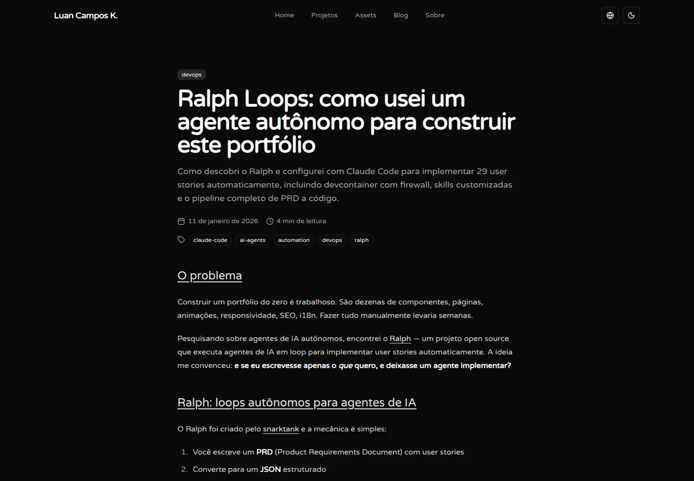
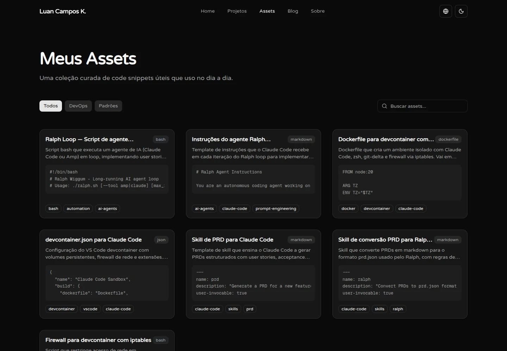
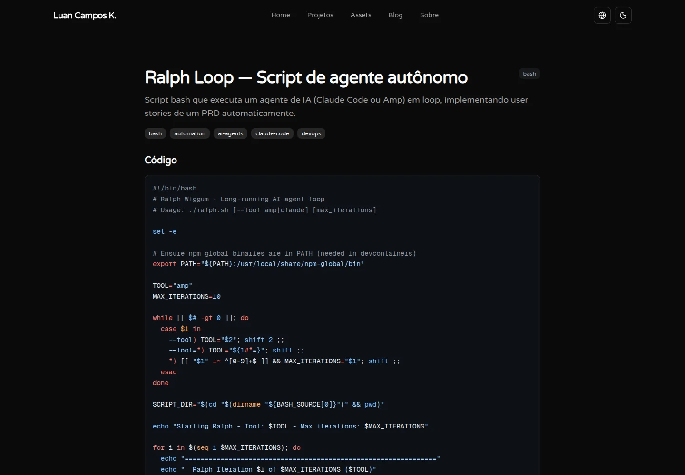

# Luan Campos K. — software engineering portfolio

A personal portfolio bringing together professional projects, technical writing, and a collection of reusable code assets. The monorepo contains a Next.js application and a new Django project that will support future backend features.

**[Visit the portfolio →](https://luancamposk.dev)**



## Visual showcase

The project collection presents work through filterable cards that lead to dedicated detail pages with context, technologies, and galleries.



The technical blog renders MDX articles with linked headings and a dedicated reading layout. The article shown here is published in Portuguese.



The code asset library combines searchable cards with detail pages for highlighted source code and explanations. These views show the portfolio's own interface, with examples from its content collection.





## Architecture and project structure

```text
apps/
├── web/                      Next.js application
│   ├── content/blog/         MDX articles and frontmatter
│   ├── messages/             Interface translations
│   ├── public/               Images, fonts, and static files
│   └── src/
│       ├── app/              Routes, layouts, metadata, and page composition
│       ├── modules/          Project, blog, asset, and content data
│       ├── shared/           Components, hooks, and utilities
│       ├── i18n/             Locale routing and message loading
│       └── proxy.ts          Locale-aware request routing
└── api/                      Django project and Python dependencies
.github/workflows/            Web and API checks
docs/                         Project documentation
```

Route files compose pages and generate metadata while the content modules own data access and content-specific operations. Shared components provide the visual building blocks used across routes. This keeps an article's MDX parsing and validation separate from its page layout, while leaving route behavior visible in the App Router.

## Local development

The applications are independent and are run from their own directories.

### Web

Requires Node.js 24 and npm. Run from the repository root:

```sh
cd apps/web
npm ci
cp .env.example .env.local
npm run dev
```

Use `npm run lint`, `npx next typegen`, `npx tsc --noEmit --incremental false`, and `npm run build` to reproduce the web CI checks. The build and development server must run from `apps/web`, where the blog content and public assets live.

### API

Requires Python 3.14. Django 5.2 LTS was generated with `django-admin startproject`. From the repository root:

```sh
cd apps/api
python3 -m venv .venv
. .venv/bin/activate
python -m pip install -r requirements.txt
python manage.py migrate
python manage.py runserver
```

The initial project uses SQLite locally and has no chatbot endpoint yet. Run `python manage.py check` and `python manage.py test` for the API CI checks. Settings are read from environment variables, not automatically from `.env` files; `apps/api/.env.example` documents them. For local development `DJANGO_DEBUG` defaults to `true` and a development-only key is used. When `DJANGO_DEBUG=false`, set a unique `DJANGO_SECRET_KEY` and configure `DJANGO_ALLOWED_HOSTS`. Production hosting and security settings will be completed with the API deployment.

## Deployment

The web and API have independent deployment targets. For Vercel, set the existing project's **Root Directory** to `apps/web` when the migration is available on the linked Git branch. Keep source files outside the root directory disabled unless the web gains a documented dependency on them. `apps/web/vercel.json` defines an ignored-build script that compares web files against the last successful deployment for the same branch; when that commit is unavailable, it builds rather than skipping. Check a preview deployment and verify that an API-only change is ignored after the migration. The Django project is not deployed yet; its future CKRG deployment and OmniRoute integration are separate work.

## Engineering decisions

### Server rendering with focused client boundaries

Page and layout files are Server Components. Interactive pieces, including the navigation, filtering controls, theme switcher, and animation components, are isolated behind client boundaries. The hero and call to action dynamically load the magnetic button; the hero also loads its cursor spotlight with server rendering disabled. This keeps browser-dependent effects out of the server-rendered component tree while preserving server-side page composition.

### Content models shaped for their consumers

Projects and assets are maintained in domain modules; blog articles are read from MDX files. The blog loader validates required frontmatter, dates, locales, and duplicate locale/slug pairs before exposing published posts. Blog and asset listing pages pass summaries to client components, omitting full article bodies and asset explanations; asset code previews are limited to the first four lines. Detail pages access the complete content when needed.

### Localization tied to content availability

`next-intl` provides locale-aware routing and loads interface messages for Portuguese, English, and Spanish. Blog posts and assets carry their own locale, so translated interface routes do not imply that every content item is translated. Detail lookup and static parameters use both locale and slug; when a translation is unavailable, the language selector returns to the corresponding listing. Project data is shared across locales rather than translated in the content module.

### Search metadata and motion preferences

Pages define metadata and canonical URLs; localized content details and the sitemap derive language alternatives from available posts and assets. The homepage also includes person-shaped JSON-LD. Motion components such as project cards, text reveals, and section wrappers check the reduced-motion preference, and the layout provides a skip link. These are targeted measures within the implementation rather than a claim of comprehensive accessibility coverage.

## Technology stack

| Responsibility | Technologies |
| --- | --- |
| Web application | Next.js 16, React 19, TypeScript |
| API foundation | Python 3.14, Django 5.2 LTS |
| Styling and UI | Tailwind CSS v4, shadcn/ui, Base UI |
| Interaction | Motion, Embla Carousel |
| Internationalization | next-intl |
| Content and code | MDX, gray-matter, rehype, Shiki |
| Development tooling | Biome |

## About the developer

Luan Campos K. is a software engineer whose work spans full-stack development, software architecture, and building web applications.

[Portfolio](https://luancamposk.dev) · [GitHub](https://github.com/luancamposck)
